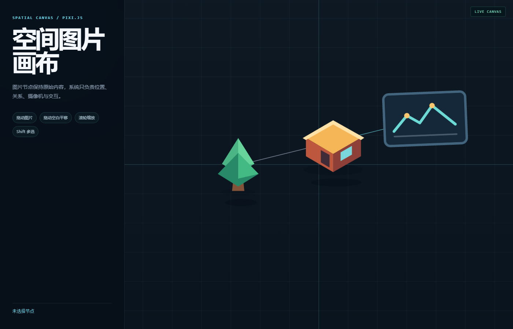

# Pixi Demo

该目录是 Spatial Canvas 核心模块的可视化示例。



## 启动

在项目根目录执行：

```bash
npm run dev
```

打开：

```text
http://localhost:5173
```

## 构建

```bash
npm run build
```

构建结果输出到根目录的 `dist`。

## 示例覆盖的能力

- 创建 `Scene`、`ImageNode` 和 `Edge`
- 使用 `Camera` 进行世界坐标转换
- 使用 `PixiSpatialRenderer` 同步 Pixi 视图
- 节点选择和拖动
- 空白区域平移
- 鼠标滚轮缩放
- 图片锚点
- 连接线
- 可选阴影
- 深度顺序

`pixi-view-factory.ts` 是 Demo 对 Pixi.js 的具体适配。核心目录 `/src` 仍然不直接依赖 Pixi.js。
